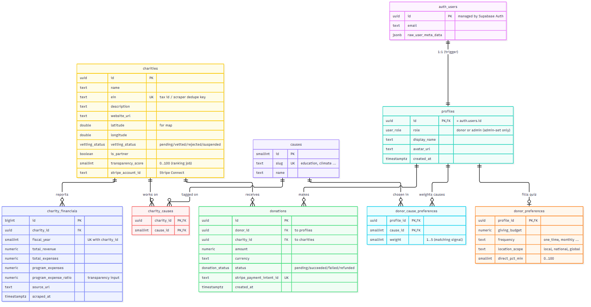
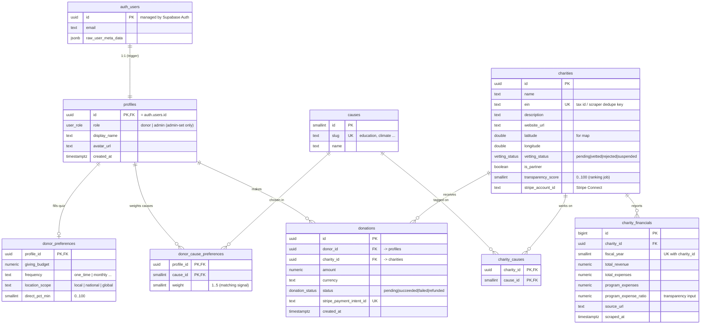

# ClearCause — Entity Relationship Diagram

Visual map of the database defined in
[`supabase/migrations/0001_initial_schema.sql`](../supabase/migrations/0001_initial_schema.sql).

**Scope:** Phase 1 / MVP (Local charities). Covers sign-up, the onboarding quiz,
charity browsing + transparency, and donations. Gamification, news feed, charity
applications, and split donations are deferred to later phases.

**Model:** Only **donors** and **admins** log in. Charities are admin-curated
data records (scraper-fed + vetted), not accounts.

> Renders automatically on GitHub. In VS Code, install the "Markdown Preview
> Mermaid Support" extension to preview locally.
>
> A rendered image is also available at [`ERD.png`](./ERD.png) (regenerate with
> `npx @mermaid-js/mermaid-cli -i erd.mmd -o docs/ERD.png -b white -s 2`).

## Notes

- **`auth_users`** is shown as `auth.users`, Supabase's managed auth table. A
  trigger mirrors each signup into `profiles` (1:1).
- A donation references a **single** charity for MVP. Splitting one donation
  across multiple charities ("division of money") returns in a later phase.
- Charity **transparency score** lives as a column on `charities` (updated by
  the ranking job). Score history as its own table is deferred.

### Relationship legend

| Symbol | Meaning |
|--------|---------|
| `\|\|--\|\|` | exactly one to exactly one |
| `\|\|--o\|` | one to zero-or-one (optional) |
| `\|\|--o{` | one to zero-or-many |
| `PK` / `FK` / `UK` | primary key / foreign key / unique key |

### Who can write what (RLS summary)

| Written by **browser** (anon key, RLS) | Written by **service role** only (no write policy) |
|---|---|
| `donor_preferences`, `donor_cause_preferences` (own) | `charity_financials` (scraper) |
| `profiles` (own, except `role`) | `charities.transparency_score` (ranking job) |
| | `donations` (Stripe webhook) |

## Deferred to later phases

Removed from the MVP to keep it lean — reintroduce when the phase calls for it:

- **Gamification** — badges, user badges, streaks, leaderboard
- **News feed** — editorial posts
- **Charity applications** — the public "request form" (handled off-DB at first)
- **Split donations** — `donation_allocations`
- **Ranking history** — per-charity score over time
